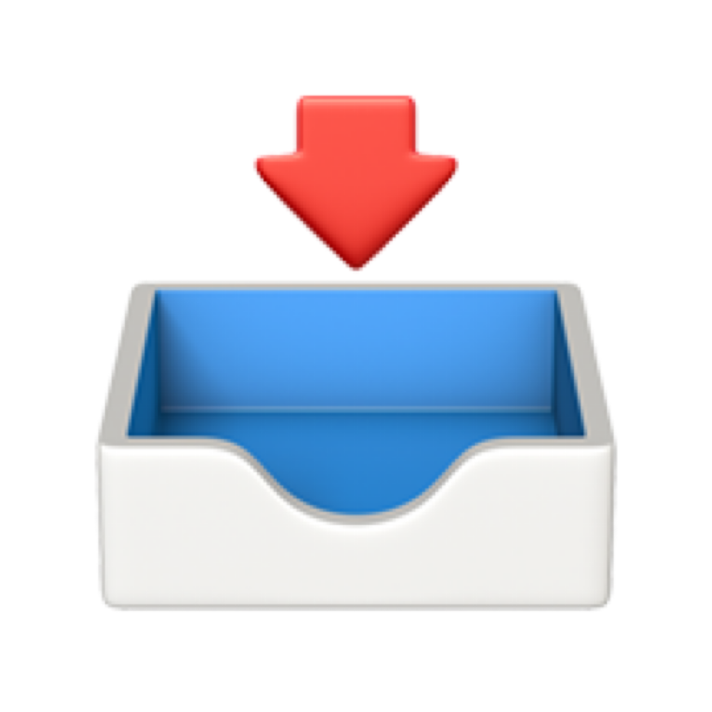

<p align="center">
  
</p>

# Mercury

**English** | [日本語](README.ja.md)

A tiny, free, open-source macOS menu bar app that watches your Gmail over
IMAP **IDLE** and shows a native notification the moment mail arrives. No
polling, no need to keep Mail.app open, no Dock icon, no telemetry.

## Features

- Instant notifications (Gmail pushes to Mercury, nothing to wait for)
- Up to two Gmail accounts, with unread counts in the menu bar
- Recent messages list: unread first, or chronological
- Quick actions per message: flag, mark read/unread, copy a verification code, pick a link from the email
- Optional swipeable panel (beta): swipe messages with two fingers like Mail.app, with an optional Liquid Glass look
- Open messages in Mail.app or Gmail, global shortcut, pause notifications, launch at login

## Install

**Download:** get the latest `Mercury.dmg` from [Releases](../../releases), open it,
and drag `Mercury` to `Applications`. It is signed and notarized by Apple, so it
opens without any Gatekeeper workaround.

**Build it yourself** (needs only the Xcode Command Line Tools):

```bash
git clone https://github.com/FireBarret/mercury.git
cd mercury
./build_app.sh
open build/Mercury.app
```

## Setup

Gmail needs an **App Password** for third-party apps:

1. Turn on [2-Step Verification](https://myaccount.google.com/signinoptions/two-step-verification)
2. Create an [app password](https://myaccount.google.com/apppasswords)
3. Open Mercury, enter your Gmail address and the app password, and click **Save & Connect**

## Using it

- Click the menu bar icon for recent mail, **Check Now**, **Open Gmail**,
  **Pause Notifications**, **Mark All as Read**, and **Preferences**.
- Click a notification to open that message. Preferences lets you choose Mail.app or Gmail in the browser.
- Mercury can refresh Mail.app in the background when mail arrives (Preferences →
  "When new mail arrives"). The first time, macOS asks to let Mercury control Mail.
- Set a global shortcut in Preferences → General.
- **Swipeable panel (beta):** turn it on in Preferences → General. Swipe a message right
  or left to reveal actions; swipe far to trigger the outer one. You choose which actions
  go where. ⌘, opens Preferences and Esc closes the panel.

If notifications don't appear, check System Settings → Notifications → Mercury.
macOS also silences banners while you share your screen.

## Privacy

- App passwords are stored in your macOS Keychain.
- Mercury only talks to `imap.gmail.com` over TLS, plus Mail.app and your local settings.
  No analytics, no third-party servers.
- Open source, small, dependency-free. Not sandboxed and not notarized.

## Contributing

Issues and PRs welcome. Please keep it small and dependency-free.

## License

[MIT](LICENSE)
